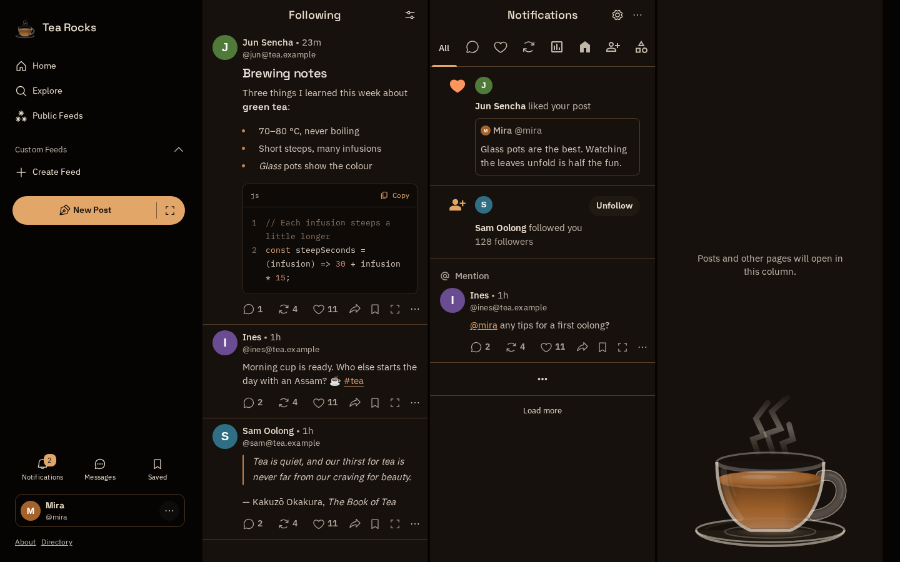
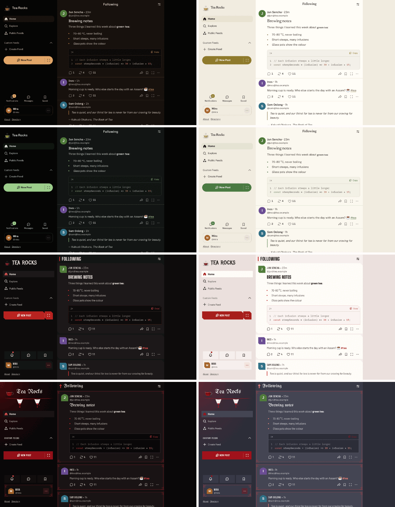
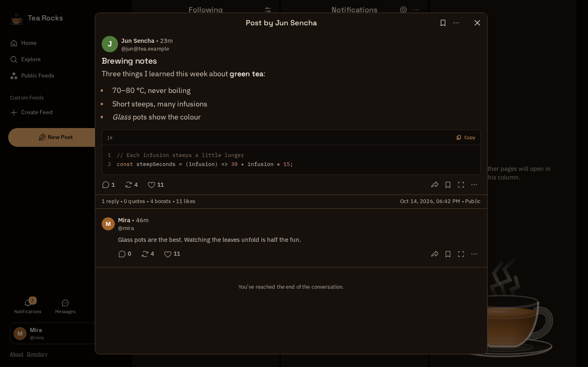
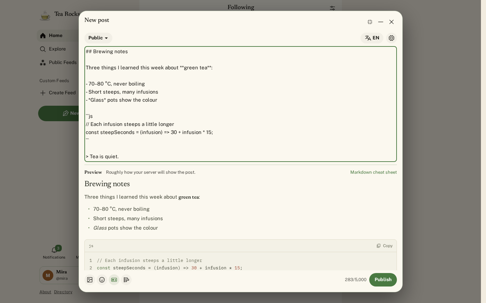
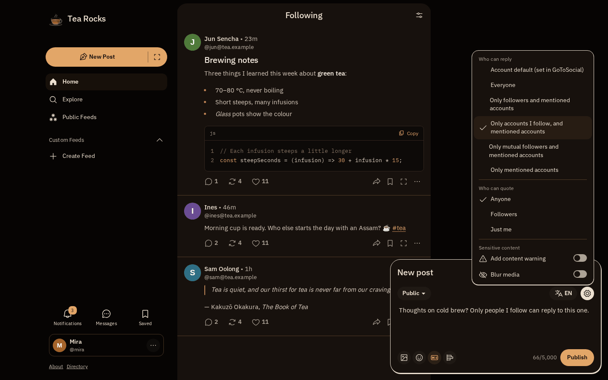

# Teadeck

Teadeck is a standalone version of [Mastodon's web interface](https://github.com/mastodon/mastodon) for Mastodon and GoToSocial servers.

It keeps Mastodon's interface and adds designs of its own, a large composer for longer posts, Markdown with a preview where the server supports it and, on GoToSocial, a choice of who can reply.

Teadeck is still in active development and has no stable release yet.



## Using Teadeck

Open a Teadeck installation, choose your language if needed, enter your server's address and sign in on your server. Choose **Stay signed in** if you want to save the account in this browser. You can add more accounts and switch between them, each with its own theme and settings.

Your browser talks directly to your Mastodon or GoToSocial server.

Unsent posts are not saved across reloads or account switches. Copy anything you want to keep first.

### What to trust

The Teadeck host supplies the JavaScript running in your browser, and that code can access your account tokens. Static hosting does not remove that risk, and the host can log visits. Use an installation you trust, or run your own on a dedicated HTTPS origin.

- OAuth uses PKCE. Authenticated API requests are restricted to the selected server, and redirects are rejected.
- Sign-in tokens stay in session storage, or also in IndexedDB when you choose **Stay signed in**. Preferences are saved in local storage. Code running on the same origin can read all of it.
- Post HTML comes from your server. Its content sanitisation and Teadeck's Content Security Policy both matter.
- The service worker caches application files, not API responses.

## Features

### Layouts and designs

Mastodon's single- and multi-column layouts, with eight designs of Teadeck's own and Mastodon's design to choose from. Hibiscus goes further than the others: chamfered corners, condensed capitals, borderless cards on spaced columns, bolder icons and a fine grain. Lapsang Souchong and Earl Grey are gothic: blackletter titles, ornaments in the corners of posts, pointed-arch avatars, fangs under the logo and an opaque blood-red tea. Layout, design and language are set per account under **Settings** in the account menu.



### Post overlay

**Open in overlay** shows a post with its thread in the middle of the window, without leaving the current view.



### Large composer

The right part of the **New post** button opens a composer as large as the post overlay, for longer posts. With Markdown on, it previews the post below the text.



### GoToSocial

Posts can be written in Markdown, and the composer's settings choose who can reply to a post. Mastodon features GoToSocial lacks are left out. See [Configuration](docs/configuration.md) for the details.



## Deploying

### Docker Compose

The easiest way to run Teadeck is with the published container image. You need Docker and Compose.

Download [compose.yml.example](compose.yml.example) and [.env.example](.env.example) into the same directory, then run:

```sh
cp compose.yml.example compose.yml
cp .env.example .env
mkdir -p logo
docker compose pull
docker compose up -d
```

The container serves Teadeck on port **8080**, published on all host interfaces by default. Open `http://localhost:8080` on the Docker host to try it. For public access, put an HTTPS reverse proxy such as Caddy or nginx in front of it.

Use `.env` to choose a different port, logo or default theme. See [Configuration](docs/configuration.md) for the options and [Deployment](docs/deployment.md) for updates and rollbacks.

### Without Docker

Build Teadeck as described below, then serve the contents of `dist/` with a web server. Use [container/nginx.conf](container/nginx.conf) as a reference for routing, caching and security headers, adjusting the container-specific paths for your setup. Requests to app routes must fall back to `index.html`.

With either method, serve Teadeck at the root of a domain, not under a path such as `/teadeck`. Your Mastodon or GoToSocial server must use HTTPS.

## Building

The build fetches the Mastodon commit pinned in [upstream.lock.json](upstream.lock.json), applies the changes in [patches/](patches/) on top and adds the integration code in [integration/](integration/).

You need a full checkout, **Node.js 24.2 or newer**, npm, Corepack, Git and GNU tar. The first build downloads Mastodon and its dependencies, so allow several GB of disk space.

From the repository directory, run:

```sh
npm run doctor
npm run build:fresh
```

The finished web app is in `dist/`. To package your build in a container and run it:

```sh
mkdir -p logo
docker compose -f compose.yml.example -f compose.build.yml up -d --build
```

For development and tests, see [Contributing](CONTRIBUTING.md).

## License

Teadeck is licensed under [AGPL-3.0-or-later](LICENSE), as is Mastodon. See [NOTICE](NOTICE) for attribution and [integration/fonts](integration/fonts/) for font licenses. Each build includes its source code and build instructions at `/source.tar.gz`.
